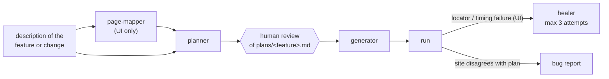

# playwright-ai-qa-agents

[](https://github.com/benweese/playwright-ai-qa-agents/actions/workflows/validate.yml)

A [Claude Code](https://claude.com/claude-code) plugin, `playwright-qa-agents`, that turns "test this feature" into reviewed, runnable Playwright tests. Agents plan the scenarios, stop for a human to review the plan, then write the API clients, page objects and specs, run them, and repair broken UI locators within a fixed budget.

It is one of three repos that work together:

| Repo | Role |
|---|---|
| [playwright-test-commons](https://github.com/benweese/playwright-test-commons) | Shared framework code the generated tests use |
| **playwright-ai-qa-agents** (this repo) | The Claude Code plugin |
| [playwright-e2e-demo](https://github.com/benweese/playwright-e2e-demo) | A real suite for [automationexercise.com](https://automationexercise.com), written with this plugin |

## The workflow



The plan opens with numbered acceptance criteria (`AC-1`, `AC-2`, ...), and each scenario lists the criteria it covers. Each scenario also gets an id (`PROD-003`) that goes into its test title. A failing test points straight back to its written steps, its expected result and the requirement behind it.

## What's inside

| Agent | Job |
|---|---|
| `page-mapper` | Walks one live page with `playwright-cli` and documents its controls, URL params, validation and empty states in `docs/pages/<page>.md` |
| `api-test-planner` / `ui-test-planner` | Turn the description into numbered acceptance criteria, then hand-runnable scenarios that cover them. Check existing tests and clients first, so nothing is duplicated or invented |
| `api-test-generator` | Writes the spec and any planned client methods, generates and tightens JSON schemas, lints and runs |
| `ui-test-generator` | Writes locators → page object → spec, using the locators the live page actually exposes |
| `ui-test-healer` | Fixes drift, ambiguity and timing failures, one test at a time, with at most 3 attempts per test |

| Skill | Use |
|---|---|
| `/playwright-qa-agents:author-tests <feature>` | The full flow above |
| `/playwright-qa-agents:run-spec <path \| project \| id>` | Run and summarize |
| `/playwright-qa-agents:check [fix]` | Lint |
| `/playwright-qa-agents:bug-report <description>` | Write a bug report to `bugs/` |

## Guardrails

These rules exist because AI test authoring fails in predictable ways:

- **Plan, review, then generate.** Duplicate scenarios, untestable criteria and wrong assumptions are cheapest to catch in a plan, before code exists.
- **Assert the plan, not what you see.** An agent driving a live site will happily encode a bug as expected behaviour. Generators and the healer keep the plan's assertion, leave the test failing, and report the difference.
- **A healing budget.** Three attempts per test, then a `// Fixme:` note saying what was tried. Without a limit, a healer flips between locators forever.
- **Two-tier locators.** Elements are acted on only through `getBy*`. When no good locator is unique on its own, the agent scopes to a good container first (the nearest meaningful parent, such as a form, dialog, row or card) and finds the element inside it. No XPath, generated class names or `.nth()`.
- **The test repo's `CLAUDE.md` wins.** Agents read the repo's own rules, helpers and site quirks before applying their defaults, so the plugin works across different suites.

## Install

In the test repo's `.claude/settings.json`:

```json
{
	"extraKnownMarketplaces": {
		"playwright-ai-qa-agents": {
			"source": { "source": "github", "repo": "benweese/playwright-ai-qa-agents" }
		}
	},
	"enabledPlugins": {
		"playwright-qa-agents@playwright-ai-qa-agents": true
	}
}
```

Or from inside Claude Code:

```
/plugin marketplace add benweese/playwright-ai-qa-agents
/plugin install playwright-qa-agents@playwright-ai-qa-agents
```

### What the test repo needs

The agents expect the layout used by [playwright-e2e-demo](https://github.com/benweese/playwright-e2e-demo): `api/` clients, `tests/api|ui/` specs, `schemas/`, `plans/`, `docs/pages/`, a `playwright.config.js` at the repo root, and a `CLAUDE.md` that describes the repo's rules. The tests use [playwright-test-commons](https://github.com/benweese/playwright-test-commons).

## Development

```bash
claude plugin validate .
```

After editing, run `/reload-plugins` in Claude Code.

## License

MIT
