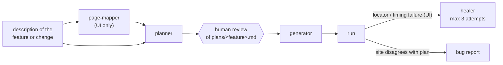

# playwright-ai-qa-agents

[](https://github.com/benweese/playwright-ai-qa-agents/actions/workflows/validate.yml)

A [Claude Code](https://claude.com/claude-code) plugin, `playwright-qa-agents`, that turns "test this feature" into reviewed, runnable Playwright tests in TypeScript. Agents plan the scenarios, stop for a human to review the plan, then write the API clients, page objects and specs, run them, and repair broken UI locators within a fixed budget.

## How it fits

It is one of three repos that work together:

| Repo                                                                           | Role                                                                                                |
| ------------------------------------------------------------------------------ | --------------------------------------------------------------------------------------------------- |
| [playwright-test-commons](https://github.com/benweese/playwright-test-commons) | Shared framework code the generated tests use                                                       |
| **playwright-ai-qa-agents** (this repo)                                        | The Claude Code plugin                                                                              |
| [playwright-e2e-demo](https://github.com/benweese/playwright-e2e-demo)         | A real suite for [automationexercise.com](https://automationexercise.com), written with this plugin |

## The workflow



The plan opens with numbered acceptance criteria (`AC-1`, `AC-2`, ...), and each scenario lists the criteria it covers. Each scenario also gets an id, a number unique across the repo (`#0012`), that goes into its test title. Ids don't encode the kind of test; tags such as `@smoke`, `@api` and `@ui` do. A failing test points straight back to its written steps, its expected result and the requirement behind it.

[docs/worked-example.md](docs/worked-example.md) follows one real feature, the cart in playwright-e2e-demo, through every stage, from page map to the healer's final diff.

## Requirements

- [Claude Code](https://claude.com/claude-code)
- A test repo laid out like [playwright-e2e-demo](https://github.com/benweese/playwright-e2e-demo) (see [What the test repo needs](#what-the-test-repo-needs))

## Install

From a terminal, in the test repo:

```bash
claude plugin marketplace add benweese/playwright-ai-qa-agents
claude plugin install playwright-qa-agents@playwright-ai-qa-agents
```

The terminal works everywhere. The `/plugin` command isn't available in every client (the VS Code extension doesn't have it); where it is, these do the same:

```
/plugin marketplace add benweese/playwright-ai-qa-agents
/plugin install playwright-qa-agents@playwright-ai-qa-agents
```

**Plugins load when a session starts.** After installing, start a new Claude Code session before using the agents. In VS Code, run **Developer: Reload Window** from the command palette, or open a new Claude Code tab.

To suggest the plugin to everyone who opens the test repo, also name it in the repo's `.claude/settings.json`:

```json
{
  "extraKnownMarketplaces": {
    "playwright-ai-qa-agents": {
      "source": {
        "source": "github",
        "repo": "benweese/playwright-ai-qa-agents"
      }
    }
  },
  "enabledPlugins": {
    "playwright-qa-agents@playwright-ai-qa-agents": true
  }
}
```

This records the marketplace and the plugin, but it doesn't install it on its own: in the VS Code extension the plugin didn't load from this file alone, only after the terminal install above. Keep the terminal steps in the test repo's README.

To pick up a new version, run `claude plugin update playwright-qa-agents@playwright-ai-qa-agents` (or `/plugin update`), then start a new session.

### Check it loaded

Claude Code no longer has an `/agents` command. Instead, ask Claude in the new session:

```
List the subagents and skills from the playwright-qa-agents plugin.
```

It should name six agents (`page-mapper`, `api-test-planner`, `ui-test-planner`, `api-test-generator`, `ui-test-generator`, `ui-test-healer`) and the skills in the [Skills](#skills) table, each prefixed `playwright-qa-agents:`. If it finds none, the plugin isn't installed or the session started before the install: run `claude plugin list` in a terminal, then start a new session.

### What the test repo needs

- The layout used by playwright-e2e-demo: `api/` clients, `tests/api/` and `tests/ui/` specs, `schemas/`, `plans/` and `docs/pages/`
- TypeScript, with `playwright.config.ts` at the repo root
- [playwright-test-commons](https://github.com/benweese/playwright-test-commons) v0.7.0 or later (typed API responses, numeric test ids, and the `BasePage` checks, accessibility scan and `uniqueEmail` the generators use)
- `@playwright/cli` as a dev dependency, for the agents that drive a browser
- `npm run lint` that includes the type-check (and ideally JSDoc rules)
- A `CLAUDE.md` describing the repo's rules, helpers and site quirks, ideally split into a short root file and a guide per folder (`api/`, `tests/api/`, `tests/ui/`, `plans/`, ...) so each session loads only what it needs. Agents follow them over their own defaults

## Usage

Start the whole flow with a description of the feature or change, a page URL, or a path to a requirements file:

```
/playwright-qa-agents:author-tests the product search page and POST /api/searchProduct
```

It maps the page, drafts `plans/<feature>.md` and **stops for your review**. Once you approve the plan, it generates the tests, runs them, and heals UI locator failures.

### Agents

| Agent                                  | Job                                                                                                                                                                                                                                                                                                                                                                                                                                                        |
| -------------------------------------- | ---------------------------------------------------------------------------------------------------------------------------------------------------------------------------------------------------------------------------------------------------------------------------------------------------------------------------------------------------------------------------------------------------------------------------------------------------------- |
| `page-mapper`                          | Walks one live page with `playwright-cli`, in its own browser session, and documents its controls, input behaviour, URL params, validation, success, empty and error states, and multi-page flows in `docs/pages/<page>.md`. It records what the page does today, and flags what looks like a bug                                                                                                                                                          |
| `api-test-planner` / `ui-test-planner` | Turn the description into numbered acceptance criteria, then hand-runnable scenarios that cover them. They check existing tests and clients first, so nothing is duplicated or invented. The API planner lists the schemas needed and leaves undocumented negative cases as open questions; the UI planner writes expected results from the requirement, not the page, lists the differences as expected findings, and checks every element can be located |
| `api-test-generator`                   | Writes the spec and any planned client methods (typed and documented), generates and tightens JSON schemas with `UPDATE_SCHEMAS=true`, lints and runs                                                                                                                                                                                                                                                                                                      |
| `ui-test-generator`                    | Checks the plan was approved, then writes locators → page object → spec, using the locators the live page actually exposes, in its own browser session. Deletes anything it creates while exploring                                                                                                                                                                                                                                                        |
| `ui-test-healer`                       | Fixes drift, ambiguity and timing failures, one test at a time, in its own browser session, with at most 3 attempts per test. Marks plan-vs-page mismatches `test.fixme()` instead of changing the assertion                                                                                                                                                                                                                                               |

### Skills

| Skill                                                    | Use                                                                                                                                                                                                            |
| -------------------------------------------------------- | -------------------------------------------------------------------------------------------------------------------------------------------------------------------------------------------------------------- |
| `/playwright-qa-agents:author-tests <feature>`           | The full flow above                                                                                                                                                                                            |
| `/playwright-qa-agents:run-spec <path \| project \| id>` | Run a spec, a project (`smoke`, `api`, `ui`) or one test by id (`12` or `#0012`), and summarize                                                                                                                |
| `/playwright-qa-agents:check [fix]`                      | Run the repo's lint, optionally auto-fixing                                                                                                                                                                    |
| `/playwright-qa-agents:bug-report <description>`         | Write a bug report to `bugs/`, using the test and plan if a test id is given                                                                                                                                   |
| `/playwright-qa-agents:update-docs [path]`               | Bring the docs up to date: a detailed README that matches the code, `CLAUDE.md` split into a root file and folder guides, JSDoc on everything, and only comments that explain why. Proves no behaviour changed |
| `/playwright-qa-agents:playwright-cli`                   | Playwright's own skill for driving a browser with `playwright-cli`, used by the page-mapper, UI generator and healer (see below)                                                                               |

## Guardrails

These rules exist because AI test authoring fails in predictable ways:

- **Plan, review, then generate.** Duplicate scenarios, untestable criteria and wrong assumptions are cheapest to catch in a plan, before code exists.
- **Assert the plan, not what you see.** An agent driving a live site will happily encode a bug as expected behaviour. Generators keep the plan's assertion, leave the test failing, and report the difference. The healer never changes an assertion to match the page: it marks the test `test.fixme()` with the expected and actual result, so the suite stays green while the bug is tracked in the test itself.
- **A healing budget.** Three attempts per test, then a `// Fixme:` note saying what was tried. Without a limit, a healer flips between locators forever.
- **Two-tier locators.** Elements are acted on through `getBy*`, plus whatever the test repo's `tests/ui/CLAUDE.md` also allows (such as stable `data-*` attributes). When no good locator is unique on its own, the agent scopes to a good container first (the nearest meaningful parent, such as a form, dialog, row or card) and finds the element inside it. No XPath, generated class names or `.nth()`.
- **Parallel, not serial.** Following Playwright's best practice, every test is isolated and can run in parallel. One failure in a serial block skips the rest and hides what they'd find, so a dependent journey is one test with a `test.step` per stage, and tests that share data create it per worker.
- **Clean up and go easy on shared sites.** Each agent uses its own named browser session, records and deletes any account or record it creates, and never raises the worker count against a site other people use.
- **Shared helpers go to commons.** A helper any site could use belongs in playwright-test-commons, not the test repo; generators report it as a commons candidate instead of adding a local helper file.
- **The test repo's `CLAUDE.md` wins.** Agents read the repo's own rules, helpers and site quirks before applying their defaults, so the plugin works across different suites.

## What review caught

These cases come from building [playwright-e2e-demo](https://github.com/benweese/playwright-e2e-demo) (54 tests plus setup and teardown). Each one is a place where the human checkpoint or a guardrail changed what shipped. [docs/worked-example.md](docs/worked-example.md) follows one feature through every stage.

| What the agents produced                                                                                                                                                       | Caught by                                       | What changed                                                                                                                                                                                |
| ------------------------------------------------------------------------------------------------------------------------------------------------------------------------------ | ----------------------------------------------- | ------------------------------------------------------------------------------------------------------------------------------------------------------------------------------------------- |
| #0042 expected the "Order Placed!" text the page-mapper saw, not the documented "Your order has been placed successfully!". The test would have passed and hidden the mismatch | Plan review                                     | It asserts the documented text and fails on purpose. The UI planner now writes expected results from the requirement and lists differences as "Expected findings"                           |
| #0007 (search) accepted empty results, and #0017 (update account) never read the update back. Both could pass with nothing working                                             | Plan review                                     | #0007 requires products for each documented term, and #0017 reads the account back                                                                                                          |
| #0029 assumed search matches product names only; the docs say "related". The plan's own example was wrong too                                                                  | Plan review                                     | A match counts in name, category or brand, checked against the API                                                                                                                          |
| 11 UI scenarios were tagged `@smoke` as well as `@ui`. Projects select by tag, so a run of every project would run them twice, and #0042 would place two orders                | Plan review                                     | CI runs `--project=api --project=ui`, so each test runs once. The UI planner now checks `@smoke` against the config's project tags                                                          |
| The page map recommended an id plus class name, and `.first()`. The grid's "Add to cart" couldn't be located under the rules at all                                            | Locator guardrail, then plan review             | The repo allows stable `data-*` attributes and exactly two ids. Four locators still outside the rules keep a `// Fixme:` saying what the site needs                                         |
| The API generator wrapped the accounts tests in `test.describe.serial`, so one failure would skip the rest                                                                     | Code review against the "never serial" rule     | Plain `test.describe` with per-worker data, verified across two runs. Both generators now say "parallel, not serial"                                                                        |
| At default parallelism the shared site answered "503 heavy load": 19 failures, against 10 at two workers                                                                       | Run review                                      | `workers: 2` in the config. Generators and the healer never raise workers, and suspect overload before blaming a locator                                                                    |
| #0037 failed intermittently: the remove click landed before the site's script bound its handler                                                                                | Healing budget and "never change the assertion" | Fixed in 1 of 3 attempts by waiting for page load and the remove response, assertion untouched. The wait now lives in commons as `clickAndWaitForResponse`                                  |
| The API planner found negative cases the docs don't cover (such as a duplicate email on create)                                                                                | "Don't invent expected results" (planner rule)  | Listed as open questions instead of guessed status codes. The reviewer kept them out of scope                                                                                               |
| The UI generator left a throwaway account on the live site when a script errored and lost its email                                                                            | Nothing in time; found at run review            | The page-mapper, UI generator and healer now write down a record's identifying values before creating it. The suite's test emails now use the owner's domain, so leftovers are recognisable |

## Limitations

### What the agents get wrong

From the playwright-e2e-demo build. The guardrails above reduce these, but don't remove them:

- **They copy what they see into what they expect.** A planner with a page map open will write today's text as the expected result. The "requirement wins over the page" rule catches most cases. The reviewer still has to check the expected results against the source.
- **They write assertions that pass with nothing working:** a search test that accepts empty results, an update test that trusts the success message.
- **They reach for serial mode and shared state** when tests depend on each other.
- **They suggest locators the rules forbid,** or techniques nobody has tried. The page map recommended an id plus a class name, and the planner suggested a visibility filter that didn't work.
- **They miss timing that depends on the site's own scripts.** The page-mapper noted a click that "landed before page scripts were ready", and nothing downstream acted on it until #0037 failed. The healer fixes such failures afterwards, but it can't always reproduce them, and its prompt has no specific guidance yet for controls whose handlers bind late.
- **They treat a few passing runs as proof.** `--repeat-each=3` doesn't prove a rare race is gone.
- **They leave data behind when a script fails partway,** before the record's details were saved.
- **They can't tell an overloaded site from a broken test** without being told to look for 503s.

### Convention or enforced

Every guardrail in the agent prompts is a convention: the model is asked to follow it, and nothing stops it if it doesn't. What enforcement exists lives in the test repo's tooling, not in this plugin. playwright-e2e-demo enforces these:

| Guardrail                         | How it holds in playwright-e2e-demo                                                                                 |
| --------------------------------- | ------------------------------------------------------------------------------------------------------------------- |
| Plan, review, then generate       | Convention. `author-tests` stops for review and the generators ask, but nothing blocks calling a generator directly |
| Assert the plan, not what you see | Convention                                                                                                          |
| 3-attempt healing budget          | Convention: the healer counts its own attempts                                                                      |
| Locator rules                     | Partly enforced. Lint fails on XPath and on `.first()`/`.nth()`/`.last()`. Class names and ids are convention       |
| No fixed waits, no `networkidle`  | Enforced: lint errors                                                                                               |
| Parallel, not serial              | Convention. No lint rule blocks `test.describe.serial` or `mode: "serial"`                                          |
| No conditional skips or guards    | Warned only. `eslint-plugin-playwright` reports them as warnings, and lint passes with warnings                     |
| Unique numeric test ids           | Enforced: `check-test-ids` runs in `npm run lint`                                                                   |
| Types and JSDoc on reusable code  | Enforced: `tsc` and `eslint-plugin-jsdoc` in `npm run lint`                                                         |
| Don't raise the worker count      | Enforced by default with `workers: 2` in `playwright.config.ts`, but an agent can still pass `--workers`            |
| Named browser sessions, cleanup   | Convention                                                                                                          |
| Shared helpers go to commons      | Convention                                                                                                          |
| The test repo's `CLAUDE.md` wins  | Convention                                                                                                          |

A test repo without these lint rules gets only the conventions. This repo's own CI validates the plugin manifests. It doesn't test agent behaviour.

### Cost

Token use from the playwright-e2e-demo build, read from its session logs: 9 pages mapped, 14 API and 38 UI tests planned and generated, 1 test healed. All agents ran on Sonnet. Most input is cache reads, which cost far less than fresh input.

| Stage              | Work                                | Fresh input | Cache reads | Output   |
| ------------------ | ----------------------------------- | ----------- | ----------- | -------- |
| page-mapper        | 7 runs, 9 pages (about 56k per run) | 393k        | 3.33M       | 83k      |
| api-test-planner   | 14 endpoints, 3 plans               | 94k         | 0.17M       | 13k      |
| ui-test-planner    | 38 scenarios, 7 plans               | 160k        | 1.04M       | 35k      |
| api-test-generator | 14 tests, clients, 7 schemas        | 87k         | 0.45M       | 12k      |
| ui-test-generator  | 38 tests, including review fixes    | 365k        | 7.24M       | 86k      |
| ui-test-healer     | 1 test                              | 22k         | 0.18M       | 4k       |
| **All agents**     |                                     | **1.12M**   | **12.4M**   | **232k** |

The session that ran the agents and the reviews used more than all of them together: 654k fresh input, 31.0M cache reads and 166k output, on Opus. That session also rewrote the e2e README, set up CI and moved helpers into commons, so not all of it is pipeline cost. Expect orchestration to cost about as much as the agents.

Installed, the plugin adds about 900 tokens to every session (skill and agent descriptions). Each agent's prompt adds 1–2k tokens when it runs, and the bundled `playwright-cli` skill about 6k (from `claude plugin details`).

### When not to use it

- **There's no written requirement.** The planners need docs, published test cases or a ticket to assert against. With only the live page, you get tests that encode today's behaviour, bugs included.
- **The site has real users, payments or data you can't delete,** including production. The agents create accounts and submit forms on the live site.
- **Nobody will review the plan.** Most of the cases above were caught at review.
- **You need one or two quick tests.** Mapping and planning cost more than writing them by hand.
- **The test repo isn't set up for it:** not laid out like playwright-e2e-demo, not using playwright-test-commons, not TypeScript, or no lint. The generators assume the layout and the `BasePage` API, and without lint nothing enforces the conventions.
- **The environment is flaky or overloaded.** The healer will chase infrastructure failures as if they were locator problems.

## Bundled: Playwright's `playwright-cli` skill

`skills/playwright-cli/` is Playwright's own skill for [`@playwright/cli`](https://www.npmjs.com/package/@playwright/cli): the full command reference, plus guides on element attributes, request mocking, storage state, tracing and more. It is copied unchanged from the npm package and keeps its Apache-2.0 [LICENSE](skills/playwright-cli/LICENSE). Don't edit it here. To update it to the latest `@playwright/cli`:

```bash
tmp=$(mktemp -d)
npm pack @playwright/cli@latest --pack-destination "$tmp"
tar -xzf "$tmp"/playwright-cli-*.tgz -C "$tmp"
rm -rf skills/playwright-cli
cp -r "$tmp/package/skills/playwright-cli" skills/
cp "$tmp/package/LICENSE" skills/playwright-cli/
```

## Layout

```
.claude-plugin/plugin.json        the plugin's name, version and description
.claude-plugin/marketplace.json   makes this repo a plugin marketplace (source: ./)
agents/                           page-mapper, planners, generators, healer
skills/author-tests/              the full authoring flow
skills/run-spec/  skills/check/  skills/bug-report/  skills/update-docs/
skills/playwright-cli/            Playwright's skill, vendored (see above)
.github/workflows/validate.yml    validates the plugin on every push and pull request
```

## Development

```bash
claude plugin validate .
```

After editing, start a new Claude Code session (or run `/reload-plugins` where your client has it) to load the changes.

**Releasing:** bump `version` in both `.claude-plugin/plugin.json` and `.claude-plugin/marketplace.json`, then push to `main`. Users get it with `claude plugin update playwright-qa-agents@playwright-ai-qa-agents` (or `/plugin update` where their client has it), then a new session.

Dependabot keeps the GitHub Actions in the workflow current.

## License

MIT. The bundled `skills/playwright-cli/` is Apache-2.0, from Microsoft's `@playwright/cli`.
