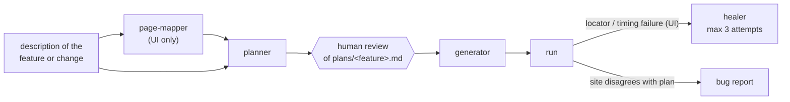

# playwright-ai-qa-agents

[](https://github.com/benweese/playwright-ai-qa-agents/actions/workflows/validate.yml)

A [Claude Code](https://claude.com/claude-code) plugin, `playwright-qa-agents`, that turns "test this feature" into reviewed, runnable Playwright tests in TypeScript. Agents plan the scenarios, stop for a human to review the plan, then write the API clients, page objects and specs, run them, and repair broken UI locators within a fixed budget.

## How it fits

It is one of three repos that work together:

| Repo                                                                           | Role                                                                                                |
| ------------------------------------------------------------------------------ | --------------------------------------------------------------------------------------------------- |
| [playwright-test-commons](https://github.com/benweese/playwright-test-commons) | Shared framework code the generated tests use                                                       |
| **playwright-ai-qa-agents** (this repo)                                        | The Claude Code plugin                                                                              |
| [playwright-e2e-demo](https://github.com/benweese/playwright-e2e-demo)         | A real suite for [automationexercise.com](https://automationexercise.com), written with this plugin |

## The workflow



The plan opens with numbered acceptance criteria (`AC-1`, `AC-2`, ...), and each scenario lists the criteria it covers. Each scenario also gets an id, a number unique across the repo (`#0012`), that goes into its test title. Ids don't encode the kind of test; tags such as `@smoke`, `@api` and `@ui` do. A failing test points straight back to its written steps, its expected result and the requirement behind it.

## Requirements

- [Claude Code](https://claude.com/claude-code)
- A test repo laid out like [playwright-e2e-demo](https://github.com/benweese/playwright-e2e-demo) (see [What the test repo needs](#what-the-test-repo-needs))

## Install

In the test repo's `.claude/settings.json`, so everyone who opens the repo gets the plugin:

```json
{
  "extraKnownMarketplaces": {
    "playwright-ai-qa-agents": {
      "source": {
        "source": "github",
        "repo": "benweese/playwright-ai-qa-agents"
      }
    }
  },
  "enabledPlugins": {
    "playwright-qa-agents@playwright-ai-qa-agents": true
  }
}
```

Or from inside Claude Code:

```
/plugin marketplace add benweese/playwright-ai-qa-agents
/plugin install playwright-qa-agents@playwright-ai-qa-agents
```

Run `/plugin update` to pick up a new version.

### What the test repo needs

- The layout used by playwright-e2e-demo: `api/` clients, `tests/api/` and `tests/ui/` specs, `schemas/`, `plans/` and `docs/pages/`
- TypeScript, with `playwright.config.ts` at the repo root
- [playwright-test-commons](https://github.com/benweese/playwright-test-commons) v0.4.0 or later (typed API responses, numeric test ids)
- `@playwright/cli` as a dev dependency, for the agents that drive a browser
- `npm run lint` that includes the type-check (and ideally JSDoc rules)
- A `CLAUDE.md` describing the repo's rules, helpers and site quirks, ideally split into a short root file and a guide per folder (`api/`, `tests/api/`, `tests/ui/`, `plans/`, ...) so each session loads only what it needs. Agents follow them over their own defaults

## Usage

Start the whole flow with a description of the feature or change, a page URL, or a path to a requirements file:

```
/playwright-qa-agents:author-tests the product search page and POST /api/searchProduct
```

It maps the page, drafts `plans/<feature>.md` and **stops for your review**. Once you approve the plan, it generates the tests, runs them, and heals UI locator failures.

### Agents

| Agent                                  | Job                                                                                                                                                                                     |
| -------------------------------------- | --------------------------------------------------------------------------------------------------------------------------------------------------------------------------------------- |
| `page-mapper`                          | Walks one live page with `playwright-cli` and documents its controls, URL params, validation and empty states in `docs/pages/<page>.md`                                                 |
| `api-test-planner` / `ui-test-planner` | Turn the description into numbered acceptance criteria, then hand-runnable scenarios that cover them. They check existing tests and clients first, so nothing is duplicated or invented |
| `api-test-generator`                   | Writes the spec and any planned client methods (typed and documented), generates and tightens JSON schemas, lints and runs                                                              |
| `ui-test-generator`                    | Writes locators → page object → spec, using the locators the live page actually exposes                                                                                                 |
| `ui-test-healer`                       | Fixes drift, ambiguity and timing failures, one test at a time, with at most 3 attempts per test                                                                                        |

### Skills

| Skill                                                    | Use                                                                                                                                                                                                            |
| -------------------------------------------------------- | -------------------------------------------------------------------------------------------------------------------------------------------------------------------------------------------------------------- |
| `/playwright-qa-agents:author-tests <feature>`           | The full flow above                                                                                                                                                                                            |
| `/playwright-qa-agents:run-spec <path \| project \| id>` | Run a spec, a project (`smoke`, `api`, `ui`) or one test by id (`12` or `#0012`), and summarize                                                                                                                |
| `/playwright-qa-agents:check [fix]`                      | Run the repo's lint, optionally auto-fixing                                                                                                                                                                    |
| `/playwright-qa-agents:bug-report <description>`         | Write a bug report to `bugs/`, using the test and plan if a test id is given                                                                                                                                   |
| `/playwright-qa-agents:update-docs [path]`               | Bring the docs up to date: a detailed README that matches the code, `CLAUDE.md` split into a root file and folder guides, JSDoc on everything, and only comments that explain why. Proves no behaviour changed |
| `/playwright-qa-agents:playwright-cli`                   | Playwright's own skill for driving a browser with `playwright-cli`, used by the page-mapper, UI generator and healer (see below)                                                                               |

## Guardrails

These rules exist because AI test authoring fails in predictable ways:

- **Plan, review, then generate.** Duplicate scenarios, untestable criteria and wrong assumptions are cheapest to catch in a plan, before code exists.
- **Assert the plan, not what you see.** An agent driving a live site will happily encode a bug as expected behaviour. Generators and the healer keep the plan's assertion, leave the test failing, and report the difference.
- **A healing budget.** Three attempts per test, then a `// Fixme:` note saying what was tried. Without a limit, a healer flips between locators forever.
- **Two-tier locators.** Elements are acted on only through `getBy*`. When no good locator is unique on its own, the agent scopes to a good container first (the nearest meaningful parent, such as a form, dialog, row or card) and finds the element inside it. No XPath, generated class names or `.nth()`.
- **The test repo's `CLAUDE.md` wins.** Agents read the repo's own rules, helpers and site quirks before applying their defaults, so the plugin works across different suites.

## Bundled: Playwright's `playwright-cli` skill

`skills/playwright-cli/` is Playwright's own skill for [`@playwright/cli`](https://www.npmjs.com/package/@playwright/cli): the full command reference, plus guides on element attributes, request mocking, storage state, tracing and more. It is copied unchanged from the npm package and keeps its Apache-2.0 [LICENSE](skills/playwright-cli/LICENSE). Don't edit it here. To update it to the latest `@playwright/cli`:

```bash
tmp=$(mktemp -d)
npm pack @playwright/cli@latest --pack-destination "$tmp"
tar -xzf "$tmp"/playwright-cli-*.tgz -C "$tmp"
rm -rf skills/playwright-cli
cp -r "$tmp/package/skills/playwright-cli" skills/
cp "$tmp/package/LICENSE" skills/playwright-cli/
```

## Layout

```
.claude-plugin/plugin.json        the plugin's name, version and description
.claude-plugin/marketplace.json   makes this repo a plugin marketplace (source: ./)
agents/                           page-mapper, planners, generators, healer
skills/author-tests/              the full authoring flow
skills/run-spec/  skills/check/  skills/bug-report/  skills/update-docs/
skills/playwright-cli/            Playwright's skill, vendored (see above)
.github/workflows/validate.yml    validates the plugin on every push and pull request
```

## Development

```bash
claude plugin validate .
```

After editing, run `/reload-plugins` in Claude Code to load the changes.

**Releasing:** bump `version` in both `.claude-plugin/plugin.json` and `.claude-plugin/marketplace.json`, then push to `main`. Users get it with `/plugin update`.

Dependabot keeps the GitHub Actions in the workflow current.

## License

MIT. The bundled `skills/playwright-cli/` is Apache-2.0, from Microsoft's `@playwright/cli`.
