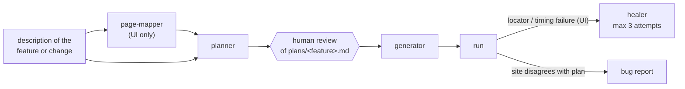

# playwright-ai-qa-agents

[](https://github.com/benweese/playwright-ai-qa-agents/actions/workflows/validate.yml)

A [Claude Code](https://claude.com/claude-code) plugin, `playwright-qa-agents`, that turns "test this feature" into reviewed, runnable Playwright tests in TypeScript. Agents plan the scenarios, stop for a human to review the plan, then write the API clients, page objects and specs, run them, and repair broken UI locators within a fixed budget.

## How it fits

It is one of three repos that work together:

| Repo                                                                           | Role                                                                                                |
| ------------------------------------------------------------------------------ | --------------------------------------------------------------------------------------------------- |
| [playwright-test-commons](https://github.com/benweese/playwright-test-commons) | Shared framework code the generated tests use                                                       |
| **playwright-ai-qa-agents** (this repo)                                        | The Claude Code plugin                                                                              |
| [playwright-e2e-demo](https://github.com/benweese/playwright-e2e-demo)         | A real suite for [automationexercise.com](https://automationexercise.com), written with this plugin |

## The workflow



The plan opens with numbered acceptance criteria (`AC-1`, `AC-2`, ...), and each scenario lists the criteria it covers. Each scenario also gets an id, a number unique across the repo (`#0012`), that goes into its test title. Ids don't encode the kind of test; tags such as `@smoke`, `@api` and `@ui` do. A failing test points straight back to its written steps, its expected result and the requirement behind it.

## Requirements

- [Claude Code](https://claude.com/claude-code)
- A test repo laid out like [playwright-e2e-demo](https://github.com/benweese/playwright-e2e-demo) (see [What the test repo needs](#what-the-test-repo-needs))

## Install

From a terminal, in the test repo:

```bash
claude plugin marketplace add benweese/playwright-ai-qa-agents
claude plugin install playwright-qa-agents@playwright-ai-qa-agents
```

The terminal works everywhere. The `/plugin` command isn't available in every client (the VS Code extension doesn't have it); where it is, these do the same:

```
/plugin marketplace add benweese/playwright-ai-qa-agents
/plugin install playwright-qa-agents@playwright-ai-qa-agents
```

**Plugins load when a session starts.** After installing, start a new Claude Code session before using the agents. In VS Code, run **Developer: Reload Window** from the command palette, or open a new Claude Code tab.

To suggest the plugin to everyone who opens the test repo, also name it in the repo's `.claude/settings.json`:

```json
{
  "extraKnownMarketplaces": {
    "playwright-ai-qa-agents": {
      "source": {
        "source": "github",
        "repo": "benweese/playwright-ai-qa-agents"
      }
    }
  },
  "enabledPlugins": {
    "playwright-qa-agents@playwright-ai-qa-agents": true
  }
}
```

This records the marketplace and the plugin, but it doesn't install it on its own: in the VS Code extension the plugin didn't load from this file alone, only after the terminal install above. Keep the terminal steps in the test repo's README.

To pick up a new version, run `claude plugin update playwright-qa-agents@playwright-ai-qa-agents` (or `/plugin update`), then start a new session.

### Check it loaded

Claude Code no longer has an `/agents` command. Instead, ask Claude in the new session:

```
List the subagents and skills from the playwright-qa-agents plugin.
```

It should name six agents (`page-mapper`, `api-test-planner`, `ui-test-planner`, `api-test-generator`, `ui-test-generator`, `ui-test-healer`) and the skills in the [Skills](#skills) table, each prefixed `playwright-qa-agents:`. If it finds none, the plugin isn't installed or the session started before the install: run `claude plugin list` in a terminal, then start a new session.

### What the test repo needs

- The layout used by playwright-e2e-demo: `api/` clients, `tests/api/` and `tests/ui/` specs, `schemas/`, `plans/` and `docs/pages/`
- TypeScript, with `playwright.config.ts` at the repo root
- [playwright-test-commons](https://github.com/benweese/playwright-test-commons) v0.7.0 or later (typed API responses, numeric test ids, and the `BasePage` checks, accessibility scan and `uniqueEmail` the generators use)
- `@playwright/cli` as a dev dependency, for the agents that drive a browser
- `npm run lint` that includes the type-check (and ideally JSDoc rules)
- A `CLAUDE.md` describing the repo's rules, helpers and site quirks, ideally split into a short root file and a guide per folder (`api/`, `tests/api/`, `tests/ui/`, `plans/`, ...) so each session loads only what it needs. Agents follow them over their own defaults

## Usage

Start the whole flow with a description of the feature or change, a page URL, or a path to a requirements file:

```
/playwright-qa-agents:author-tests the product search page and POST /api/searchProduct
```

It maps the page, drafts `plans/<feature>.md` and **stops for your review**. Once you approve the plan, it generates the tests, runs them, and heals UI locator failures.

### Agents

| Agent                                  | Job                                                                                                                                                                                                                                                                                                                                                                                                                                                        |
| -------------------------------------- | ---------------------------------------------------------------------------------------------------------------------------------------------------------------------------------------------------------------------------------------------------------------------------------------------------------------------------------------------------------------------------------------------------------------------------------------------------------- |
| `page-mapper`                          | Walks one live page with `playwright-cli`, in its own browser session, and documents its controls, input behaviour, URL params, validation, success, empty and error states, and multi-page flows in `docs/pages/<page>.md`. It records what the page does today, and flags what looks like a bug                                                                                                                                                          |
| `api-test-planner` / `ui-test-planner` | Turn the description into numbered acceptance criteria, then hand-runnable scenarios that cover them. They check existing tests and clients first, so nothing is duplicated or invented. The API planner lists the schemas needed and leaves undocumented negative cases as open questions; the UI planner writes expected results from the requirement, not the page, lists the differences as expected findings, and checks every element can be located |
| `api-test-generator`                   | Writes the spec and any planned client methods (typed and documented), generates and tightens JSON schemas with `UPDATE_SCHEMAS=true`, lints and runs                                                                                                                                                                                                                                                                                                      |
| `ui-test-generator`                    | Writes locators → page object → spec, using the locators the live page actually exposes, in its own browser session. Deletes anything it creates while exploring                                                                                                                                                                                                                                                                                           |
| `ui-test-healer`                       | Fixes drift, ambiguity and timing failures, one test at a time, with at most 3 attempts per test                                                                                                                                                                                                                                                                                                                                                           |

### Skills

| Skill                                                    | Use                                                                                                                                                                                                            |
| -------------------------------------------------------- | -------------------------------------------------------------------------------------------------------------------------------------------------------------------------------------------------------------- |
| `/playwright-qa-agents:author-tests <feature>`           | The full flow above                                                                                                                                                                                            |
| `/playwright-qa-agents:run-spec <path \| project \| id>` | Run a spec, a project (`smoke`, `api`, `ui`) or one test by id (`12` or `#0012`), and summarize                                                                                                                |
| `/playwright-qa-agents:check [fix]`                      | Run the repo's lint, optionally auto-fixing                                                                                                                                                                    |
| `/playwright-qa-agents:bug-report <description>`         | Write a bug report to `bugs/`, using the test and plan if a test id is given                                                                                                                                   |
| `/playwright-qa-agents:update-docs [path]`               | Bring the docs up to date: a detailed README that matches the code, `CLAUDE.md` split into a root file and folder guides, JSDoc on everything, and only comments that explain why. Proves no behaviour changed |
| `/playwright-qa-agents:playwright-cli`                   | Playwright's own skill for driving a browser with `playwright-cli`, used by the page-mapper, UI generator and healer (see below)                                                                               |

## Guardrails

These rules exist because AI test authoring fails in predictable ways:

- **Plan, review, then generate.** Duplicate scenarios, untestable criteria and wrong assumptions are cheapest to catch in a plan, before code exists.
- **Assert the plan, not what you see.** An agent driving a live site will happily encode a bug as expected behaviour. Generators and the healer keep the plan's assertion, leave the test failing, and report the difference.
- **A healing budget.** Three attempts per test, then a `// Fixme:` note saying what was tried. Without a limit, a healer flips between locators forever.
- **Two-tier locators.** Elements are acted on through `getBy*`, plus whatever the test repo's `tests/ui/CLAUDE.md` also allows (such as stable `data-*` attributes). When no good locator is unique on its own, the agent scopes to a good container first (the nearest meaningful parent, such as a form, dialog, row or card) and finds the element inside it. No XPath, generated class names or `.nth()`.
- **No serial mode.** One failure in a serial block skips the rest and hides what they'd find, so tests that share data create it per worker instead.
- **Clean up and go easy on shared sites.** Each agent uses its own named browser session, records and deletes any account or record it creates, and never raises the worker count against a site other people use.
- **Shared helpers go to commons.** A helper any site could use belongs in playwright-test-commons, not the test repo; generators report it as a commons candidate instead of adding a local helper file.
- **The test repo's `CLAUDE.md` wins.** Agents read the repo's own rules, helpers and site quirks before applying their defaults, so the plugin works across different suites.

## Bundled: Playwright's `playwright-cli` skill

`skills/playwright-cli/` is Playwright's own skill for [`@playwright/cli`](https://www.npmjs.com/package/@playwright/cli): the full command reference, plus guides on element attributes, request mocking, storage state, tracing and more. It is copied unchanged from the npm package and keeps its Apache-2.0 [LICENSE](skills/playwright-cli/LICENSE). Don't edit it here. To update it to the latest `@playwright/cli`:

```bash
tmp=$(mktemp -d)
npm pack @playwright/cli@latest --pack-destination "$tmp"
tar -xzf "$tmp"/playwright-cli-*.tgz -C "$tmp"
rm -rf skills/playwright-cli
cp -r "$tmp/package/skills/playwright-cli" skills/
cp "$tmp/package/LICENSE" skills/playwright-cli/
```

## Layout

```
.claude-plugin/plugin.json        the plugin's name, version and description
.claude-plugin/marketplace.json   makes this repo a plugin marketplace (source: ./)
agents/                           page-mapper, planners, generators, healer
skills/author-tests/              the full authoring flow
skills/run-spec/  skills/check/  skills/bug-report/  skills/update-docs/
skills/playwright-cli/            Playwright's skill, vendored (see above)
.github/workflows/validate.yml    validates the plugin on every push and pull request
```

## Development

```bash
claude plugin validate .
```

After editing, start a new Claude Code session (or run `/reload-plugins` where your client has it) to load the changes.

**Releasing:** bump `version` in both `.claude-plugin/plugin.json` and `.claude-plugin/marketplace.json`, then push to `main`. Users get it with `claude plugin update playwright-qa-agents@playwright-ai-qa-agents` (or `/plugin update` where their client has it), then a new session.

Dependabot keeps the GitHub Actions in the workflow current.

## License

MIT. The bundled `skills/playwright-cli/` is Apache-2.0, from Microsoft's `@playwright/cli`.
